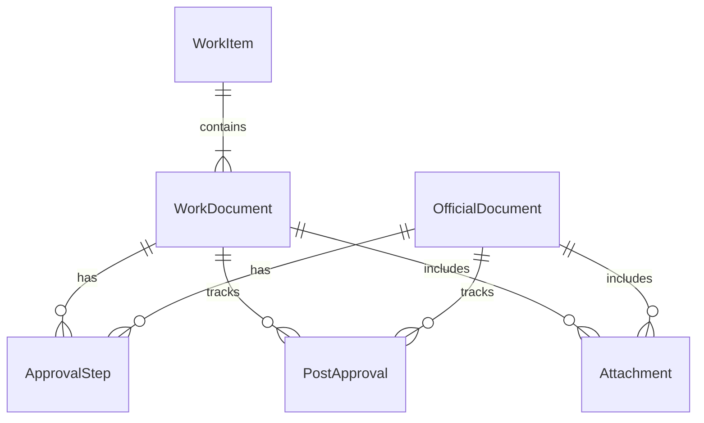

# 데이터 구조

아래 구조는 확정 요구사항을 구현하기 위한 논리 모델이다. 실제 DB 제품 및 물리 스키마는 구현 단계에서 정한다.

## 엔터티

### 업무 키워드 `WorkItem`

| 필드 | 설명 |
|---|---|
| id | 고유 식별자 |
| keyword | 업무 키워드 |
| title | 업무명/요약 |
| owner_id | 담당자 |
| description | 설명 |
| created_at, updated_at | 등록·수정 시각 |

### 업무 문서 `WorkDocument`

| 필드 | 설명 |
|---|---|
| id | 고유 식별자 |
| work_item_id | 소속 키워드 업무 |
| type | `plan`, `execution`, `payment` |
| is_default | 종류별 기본 문서인지 여부 |
| title | 문서 제목 |
| document_number | 문서번호 |
| acquired_date | 문서번호 취득일 |
| accounting_submission_required | 경리 제출 선택 여부(시행) |
| accounting_submitted_at | 경리 제출 완료 시각 |
| payment_method | `card` 또는 `cash` (지급) |
| approval_route | 아래 결재 경로 enum |
| status | 초안, 결재 중, 후결 대기, 경리 대기, 완료 등 |
| completed_at, completed_by | 완료 정보 |
| created_at, updated_at | 등록·수정 시각 |

제약: `execution` 및 `payment` 기본 문서는 업무별 1개, 계획 기본 문서도 업무별 1개를 보장한다. 추가 문서는 계획/지급으로 무제한 허용한다. 지급은 경리 제출 완료가 필수이고 지급 수단을 가져야 한다. 시행에서 경리 제출을 선택하면 제출 완료를 요구한다.

### 결재 경로 `ApprovalRoute`

| 코드 | 단계 |
|---|---|
| `director_final` | 단장 |
| `director_then_industry_president` | 단장 → (산학, 총장 병렬) |
| `director_office_industry_president` | 단장 → 사무처 → (산학, 총장 병렬) |

### 결재 단계 `ApprovalStep`

| 필드 | 설명 |
|---|---|
| id, document_id | 단계 식별자 및 일반 문서 연결 |
| step_order | 순차 단계 순번 |
| approver_role, approver_id | 역할 및 사용자 |
| status | 대기, 승인, 반려 |
| comment, rejected_reason | 의견 및 반려 사유 |
| requested_at, acted_at | 요청·처리 시각 |

공문 결재 단계는 일반 문서 연결 대신 `official_document_id`를 사용하거나 공통 `ApprovalSubject` 참조를 둔다.

### 후결 `PostApproval`

| 필드 | 설명 |
|---|---|
| id | 고유 식별자 |
| subject_type, subject_id | 일반 업무 문서 또는 공문 참조 |
| assignee_name | 자유 입력 이름 |
| status | 대기 또는 완료 |
| completed_at | 후결 완료 시각 |
| created_by, created_at | 등록자와 등록 시각 |

후결 완료는 대상 행이 1개 이상 존재할 때 전체가 완료인 경우에만 참으로 계산한다. 후결 미발생은 행이 없는 상태로 나타낸다.

### 공문 `OfficialDocument`

| 필드 | 설명 |
|---|---|
| id | 고유 식별자 |
| direction | `inbound` 또는 `outbound` |
| title | 공문 제목 |
| sender, recipient | 발신처, 수신처 |
| document_date | 공문 날짜 |
| official_number | 공문번호 |
| acquired_date | 공문번호 취득일 |
| owner_id | 담당자 |
| approval_route | 결재 경로 |
| status | 초안, 결재 중, 후결 대기, 완료 등 |
| completed_at, completed_by | 완료 정보 |
| created_at, updated_at | 등록·수정 시각 |

공문은 `WorkItem` 또는 `WorkDocument`에 연결하지 않는다. 공문번호와 취득일은 완료 게이트에서 필수다.

### 첨부파일 `Attachment`

| 필드 | 설명 |
|---|---|
| id | 고유 식별자 |
| subject_type, subject_id | 업무 문서 또는 공문 참조 |
| file_name, storage_key, mime_type, size | 파일 정보 |
| uploaded_by, uploaded_at | 등록자 및 등록 시각 |

## 관계 요약

## 상태 파생 규칙

완료 가능 여부는 저장된 단일 상태값으로 임의 결정하지 말고 아래 조건에서 계산한다.

- 결재 단계 전부 승인
- 후결 대상이 없거나 전원 완료
- 업무 문서: 문서번호와 취득일 존재
- 공문: 공문번호와 취득일 존재
- 시행: 경리 제출을 선택하지 않았거나 제출 완료
- 지급: 경리 제출 완료 및 지급 수단 선택

완료 기록은 별도의 사용자 동작 후 생성한다. 감사 추적을 위해 주요 상태 변경 이벤트를 보존한다.

