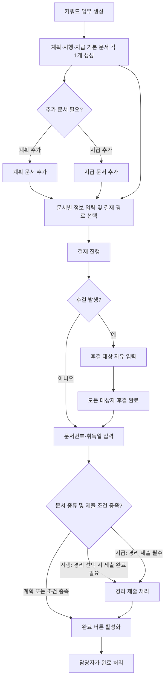
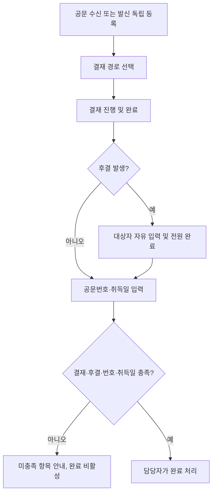

# 업무 프로세스

## 일반 업무 흐름

## 결재 경로 단계

- **단장 전결:** 단장 승인 → 결재 완료
- **단장 → 산학 및 총장:** 단장 승인 → 산학과 총장 모두 승인 → 결재 완료
- **단장 → 사무처 → 산학 및 총장:** 단장 승인 → 사무처 승인 → 산학과 총장 모두 승인 → 결재 완료
- 반려 및 재상신 세부 정책, 결재자 자동 지정 규칙은 대화에서 확정되지 않았다.

## 문서 완료 점검

1. 결재 경로가 지정되고 해당 단계의 결재가 모두 완료되었는지 확인한다.
2. 후결 발생 시 등록된 모든 후결 대상자의 완료 여부를 확인한다.
3. 문서번호와 취득일을 확인한다.
4. 시행은 경리 제출 선택 여부를 확인하고, 선택했다면 제출 완료를 요구한다.
5. 지급은 경리 제출 완료 및 카드/현금 수단 선택을 요구한다.
6. 게이트가 모두 충족되면 완료 버튼을 활성화한다. 담당자가 눌러 완료 시각과 처리자를 남긴다.

## 공문 흐름

공문은 키워드 업무와 분리되며, 계획·시행·지급 및 경리 제출을 거치지 않는다.

